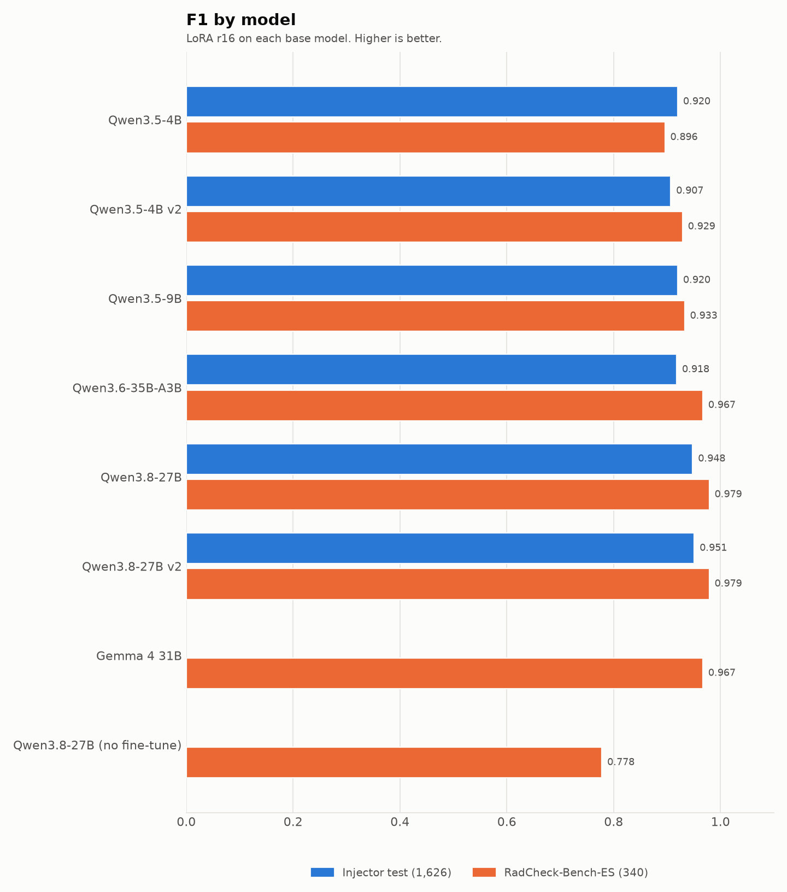

<p align="center"></p>

<h1 align="center">RadCheck-Bench-ES</h1>

<p align="center">
  A benchmark for evaluating <b>LLMs</b> on detecting <b>internal inconsistencies</b> in
  Spanish radiology reports: contradictions of laterality, negation and measurement that can
  be checked from the text alone, with no clinical knowledge.
</p>

<p align="center">
  <a href="https://github.com/crstian19/radcheck-bench-es/releases">
    
  </a>
  
  
  
  <a href="LICENSE-DATA">
    
  </a>
  <a href="LICENSE">
    
  </a>
</p>

---

**Version 1.0.0, public research preview**: the data is frozen. The radiologist review of the
sampled items is still pending, so treat the labels as unreviewed.

> **Item text, labels and explanations are in Spanish**, because that is the task. Everything
> else — this README, the code, the docs — is in English.

## Why it exists

Small models are often trained and evaluated on the same generated data. When the test set comes
from the **same rule-based injector** used for training, it shares that injector's patterns and
the scores are optimistic: the model may be learning the injector instead of the task.

RadCheck-Bench-ES breaks that dependency. Reports are written from scratch by a language model,
errors are written like real dictation slips, and half of the clean reports are hard negatives
built to look like errors.

<p align="center">
  
</p>

Blue is the injector test the project trained against, orange is this benchmark. The two bars per
model are the same fine-tuning evaluated twice; the further apart they are, the more the injector
test was flattering that model.

## What is measured

Input: the full text of one report. Output: the list of inconsistencies it contains, as JSON.

| `tipo` | Meaning | Example |
|---|---|---|
| `lateralidad` | The same finding appears with different sides | findings: cyst in the **left** kidney; conclusion: cyst in the **right** kidney |
| `negacion` | One part asserts what another part denies | findings: "no lymph nodes seen"; conclusion: "mediastinal lymph nodes" |
| `medida` | The same measurement differs (number or unit) | findings: "**9 mm** nodule"; conclusion: "**9 cm**" or "**19 mm**" |

Out of scope: whether a finding is clinically right, diagnoses, severity, recommendations.

Two further types live in the **extra** track and do not count towards the main score:
`discordancia` (a relevant finding missing from the conclusion) and `transcripcion` (a plausible
speech-recognition word swap). Current models are not trained for these.

## Quick start: evaluate your model

The scorer needs nothing beyond the standard library.

```bash
git clone https://github.com/crstian19/radcheck-bench-es
cd radcheck-bench-es
uv run python evaluate/score.py --data data/test.jsonl --pred predictions.jsonl
```

A predictions file is one JSON object per line, `output` holding the raw model text:

```json
{"id": "rcb-0001", "output": "{\"errores\": [{\"tipo\": \"lateralidad\", \"fragmento\": \"...\", \"explicacion\": \"...\"}]}"}
```

If your model is served through an OpenAI-compatible endpoint (vLLM, llama-server, TGI, Ollama),
the bundled runner sends the exact prompt stored in each item and writes that file:

```bash
uv run --extra gen python evaluate/run_openai.py \
    --data data/test.jsonl \
    --model Qwen/Qwen3-4B \
    --base-url http://localhost:8000/v1 \
    --out predictions.jsonl
```

Use `data/dev.jsonl` while you iterate and `data/test.jsonl` for the number you report.
`--out scores.json` saves the summary.

```
{
  "examples": 340,
  "overall": {"precision": 0.94, "recall": 0.93, "f1": 0.935, "support": 170},
  "per_type": {"lateralidad": {...}, "negacion": {...}, "medida": {...}},
  "false_alarm_rate": 0.012,
  "detection_rate": 0.94,
  "invalid_json_rate": 0.0
}
```

### How a prediction is matched

The `tipo` must match, and the `fragmento` is located in the report (exact, then case- and
whitespace-insensitive). It counts when it **overlaps the gold span or its counterpart**: from the
text alone either side of a contradiction may be wrong, so quoting the findings when the error is
in the conclusion is a legitimate hit. An unlocatable fragment still counts if it contains the
changed text. Unmatched predictions are false positives, unmatched gold errors false negatives,
and invalid JSON counts as "no prediction".

`evaluate/score.py` is a port of the reference implementation and does not import the training
codebase; `tests/test_score.py` pins it with hand-checked numbers.

## Results

RadCheck-Bench-ES v1 **test** split (340 items), greedy decoding, scored with
`evaluate/score.py`.

| Model | F1 | False alarms |
|---|---|---|
| Qwen3.8-27B, no fine-tune | 0.778 | 1.2% |
| radcheck Qwen3.5-4B v1 | 0.896 | 1.2% |
| radcheck Qwen3.5-4B v2 | 0.929 | 0.0% |
| radcheck Qwen3.5-4B v3 | 0.942 | 0.0% |
| radcheck Qwen3.6-35B-A3B v1 | 0.967 | 0.6% |
| Gemma 4 31B + LoRA | 0.967 | 0.0% |
| radcheck Qwen3.8-27B v2 | 0.979 | 0.0% |

The `radcheck` models were fine-tuned by the radcheck project and are **not public yet**; those
rows are context, not a reproducible baseline. The prompt-only Qwen3.8-27B row is the honest
zero-effort reference.

Compare models on the same subset only. The main score covers the three contradiction types; the
extra track is reported separately.

## Composition

400 main items (dev 60 / test 340) and 60 in the extra track.

| Slice | N |
|---|---|
| Clean, ordinary | 100 |
| **Clean, hard negative** | 100 |
| `lateralidad` | 67 |
| `negacion` | 67 |
| `medida` | 66 |
| `discordancia` (extra) | 30 |
| `transcripcion` (extra) | 30 |

**Hard negatives**, 12–22 items per pattern: different sides for different findings; asymmetric
bilateral finding; negation and assertion about different structures; the same number for
different structures; comparison with a previous study; unlateralised organs next to side words.

**Diversity**: five modalities (X-ray, CT, MRI, ultrasound, mammography), seven anatomical
regions, four writing styles at 25% each, and 60–425 words with **32% over 250**.

| Style | Shape |
|---|---|
| A | Headers in one paragraph: `EXPLORACIÓN: … HALLAZGOS: … CONCLUSIÓN: …` |
| B | Structured across lines, with bullets |
| C | Narrative ending in `IMPRESIÓN DIAGNÓSTICA` |
| D | Telegraphic, with abbreviations (`dcho`, `izq`, `LII`, `D4-D5`) |

## Repository layout

```
data/       dev test extra raw specs review stats + SHA256SUMS
evaluate/   score.py (stdlib only), run_openai.py (any OpenAI-compatible endpoint)
prompts/    templates used + PROMPTS.md and MODEL.md
scripts/    generation, validation, build, check, report
report/     self-contained web report
review/     radiologist worksheet (Spanish)
assets/     README chart
```

`dev`, `test` and `extra` are already in evaluation format: `prompt` (system plus report),
`completion` (the canonical answer), `chat_template_kwargs` and `gold`. Each gold entry carries
`tipo`, `fragmento`, `explicacion`, `start`/`end` (character offsets in the report),
`original` (the text the corruption replaced) and `counterpart` (the span it now contradicts).
Clean items have `gold: []`. `data/raw.jsonl` keeps both versions of every item
(`informe_limpio`, `informe`) for anyone who wants to study the corruption itself.

## How it was generated

1. `data/specs.jsonl` is written by a seeded script, fixing the composition before any tokens are
   spent.
2. A general-purpose LLM writes the clean report for each spec; for error slices the target
   finding must appear **twice** (findings and conclusion) so a counterpart exists.
3. A second call makes **one** minimal edit and returns the original and replaced text. The
   `fragmento` is **not written by the model**: the pipeline derives it in code from the actual
   edit, so it is always an exact substring.
4. `scripts/validate.py` applies every rule; `scripts/generate.py` retries rejected items and
   refuses to write a duplicate.
5. An **independent check** sees only the report, with another prompt and another model
   (Qwen3.8-Flash, from a **different family** than the generator); disagreements go to
   `data/review.jsonl` instead of being dropped.
6. `scripts/build.py` writes the evaluation files and the statistics.

The sampling parameters are recorded in [`prompts/MODEL.md`](prompts/MODEL.md); the templates and their English summaries are in
[`prompts/PROMPTS.md`](prompts/PROMPTS.md). The API key is read from `RADCHECK_BENCH_API_KEY` at
run time and never stored.

## Independence from the training pipeline

- **CARES was not used.** It was never downloaded, opened or read; no text derives from it. The
  optional 8-gram overlap check from the design spec therefore does not apply: only duplicate
  detection is used.
- **The rule-based injector was not used.** Corruptions are model calls with their own prompts, so
  they do not inherit the injector's eligibility rules. That is the bias this benchmark removes.

## Validation

`scripts/validate.py` passes on **460/460 items**:

- `fragmento` and `contraparte` are exact substrings of the report;
- the corrupted report differs from the clean one **only** inside the labelled fragment;
- the edit changes 1–4 tokens, and the fragment is 3–12 words;
- the counterpart does not overlap the fragment;
- sides, polarity or numbers really contradict each other, and the two mentions are related (a
  number unrelated to the edited one is rejected);
- the claimed hard-negative pattern is actually present;
- the report is complete, has no double spaces, and does not contradict itself on whether
  contrast was administered;
- no duplicate reports.

The independent cross-family check agreed with **387/400 main-track labels (96.8%)**; all 73
disagreements are published with their reason in `data/review.jsonl`. Two are cases where the
checker flagged a clean report and manual reading confirmed the checker was wrong; the rest are
known blind spots (mostly negation phrased as a nominalisation).

A perfect-oracle run on `test` scores F1 = 1.0, which confirms the gold spans and the scoring rule
agree.

## Limitations

- **Synthetic.** Reports are written by a model, not a radiologist. They cover register and
  structure, not the variety of a real department.
- **Generator bias.** Errors and texts share an author; an error that looks natural to a model may
  be rare in real practice.
- **One independent check, and it is a model.** The human review
  (`review/radiologist_review.md`) is what settles disputed labels, and it is still pending for
  the first 50 sampled items.
- **Untrained extra track.** `discordancia` and `transcripcion` are not in the training data;
  scores there measure zero-shot behaviour.
- **Fixed composition.** Slice proportions are deliberate, not the real prevalence of errors in a
  department. Do not read the false-alarm rate as a clinical error rate.

## Citation

Machine-readable metadata is in [`CITATION.cff`](CITATION.cff), which GitHub renders as a
"Cite this repository" button.

```bibtex
@misc{gutierrez2026radcheckbench,
  title        = {RadCheck-Bench-ES: detecting internal inconsistencies in Spanish
                  radiology reports},
  author       = {Gutiérrez, Cristian},
  year         = {2026},
  version      = {1.0.0},
  howpublished = {\url{https://github.com/crstian19/radcheck-bench-es}},
  note         = {Data licensed CC BY 4.0}
}
```

A Hugging Face mirror ([Crstian19/radcheck-bench-es](https://huggingface.co/datasets/Crstian19/radcheck-bench-es)) is kept alongside this repository. The GitHub repository is the
source of truth; the mirror is regenerated from it, and `data/SHA256SUMS` is the check that both
hold the same bytes.

## License

[CC BY 4.0](LICENSE-DATA) for the data (`data/`, `report/`, `review/`) and [MIT](LICENSE) for the
code (`scripts/`, `evaluate/`, `tests/`).

## Contributing

Issues that point at a wrong label are the most valuable contribution: open one with the item
`id`, the report, the current label and what you think it should be. Please do not submit reports
containing real patient data.
